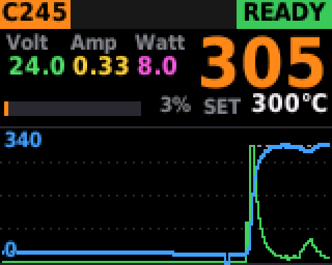
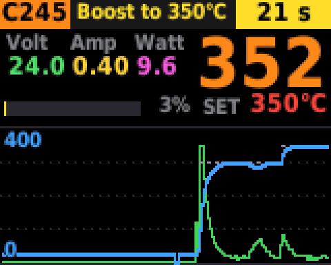
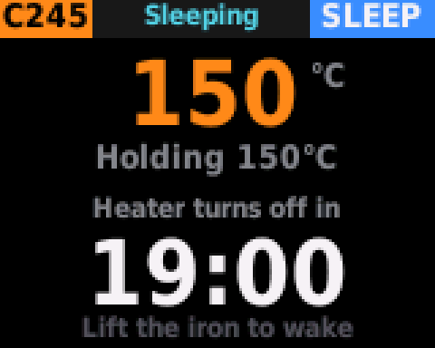
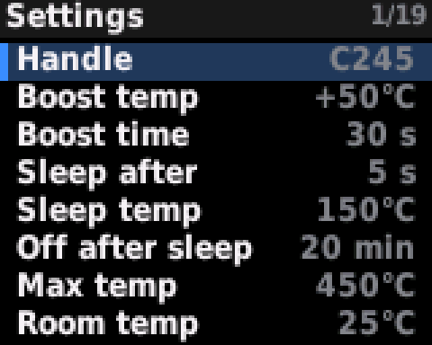
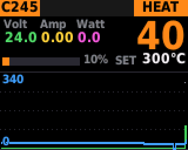
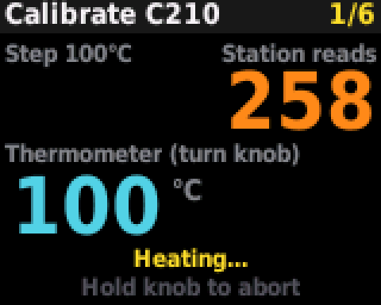
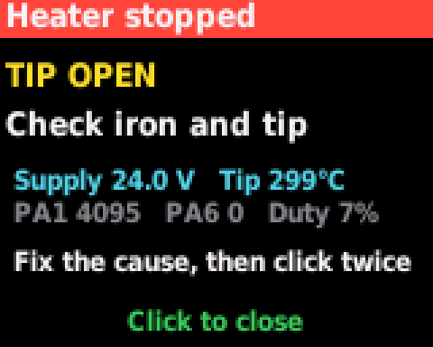
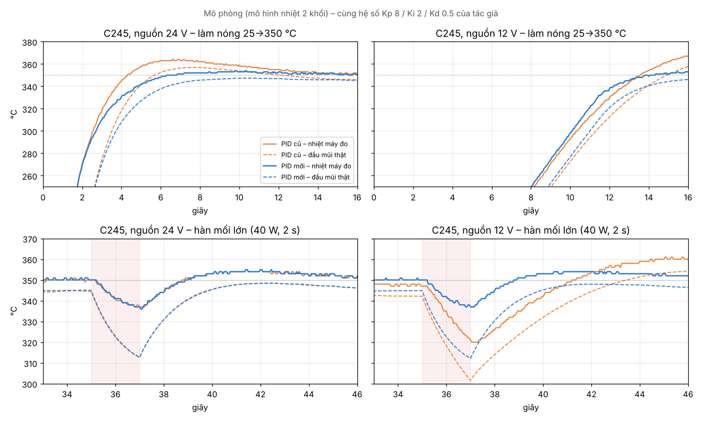

# OpenStation C245/C210

**Firmware mã nguồn mở cho trạm hàn "Trạm hàn v4 by Toanthodien16" — dành cho tay hàn JBC C245 và C210.**

Giao diện ngang rõ nét, điều khiển nhiệt ổn định trên dải nguồn 10–28 V, Boost / Sleep đầy đủ, nhớ cài đặt sau khi tắt nguồn.

<p align="center">
  
  
  
</p>
<p align="center">
  
  
  
</p>

<sub>Ảnh được vẽ bằng chính code giao diện của firmware chạy trong bộ mô phỏng trên máy tính (`sim/run.sh`). Xem **[tất cả các màn hình và ảnh động](docs/SCREENS.md)**.</sub>

> English summary at the [end of this page](#english-summary).

---

## Mục lục

- [Tính năng](#tính-năng)
- [Phần cứng](#phần-cứng)
- [Nạp firmware](#nạp-firmware)
- [Lần đầu sử dụng](#lần-đầu-sử-dụng)
- [Cách dùng](#cách-dùng)
- [Cài đặt](#cài-đặt)
- [Bộ điều khiển nhiệt](#bộ-điều-khiển-nhiệt)
- [Hiệu chuẩn tay hàn](#hiệu-chuẩn-tay-hàn)
- [Câu hỏi thường gặp](#câu-hỏi-thường-gặp)
- [Build từ mã nguồn](#build-từ-mã-nguồn)
- [Lưu ý an toàn](#lưu-ý-an-toàn)
- [Lộ trình](#lộ-trình)
- [Đóng góp](#đóng-góp)
- [Giấy phép và ghi công](#giấy-phép-và-ghi-công)

---

## Tính năng

- **Hai tay hàn: JBC C245 và C210.**
  - C245 giữ nguyên hiệu chuẩn và hệ số PID do tác giả firmware gốc đo trên mạch.
  - C210 có profile khởi đầu an toàn, khóa ở 300 °C cho tới khi được hiệu chuẩn.
- **Màn hình chính ngang 160×128:**
  - Volt / Amp / Watt, thanh công suất.
  - Biểu đồ nhiệt và công suất khoảng 80 giây.
  - Nhiệt độ mũi và nhiệt đặt dạng **số chạy**: chỉ chữ số nào đổi mới trượt lên hoặc xuống.
- **Font chữ mượt** (16 mức xám), màu theo trạng thái: OFF / HEAT / READY / BOOST / SLEEP / FAULT.
- **Boost:** bấm đúp để tăng nhiệt tạm thời. Thời gian Boost chỉ bắt đầu tính **từ lúc đạt nhiệt Boost**.
- **Sleep:** gác tay hàn lên giá thì máy hạ nhiệt chờ, đếm ngược thời gian tới lúc tắt nung. Nhấc tay hàn lên là nung lại.
- **Nhớ nhiệt đặt riêng cho từng tay hàn:** xoay núm rồi bấm 1 lần để lưu.
- **Bộ điều khiển nhiệt cải tiến:**
  - Bù điện áp nguồn.
  - Bù trước (feedforward) tự học.
  - Chống vọt nhiệt.
  - Bù nhiệt độ phòng.
- **Lưu cài đặt an toàn:** ghi xoay vòng 8 khối flash nên bền gấp 8 lần, mất điện giữa chừng vẫn giữ được bản lưu trước.
- **Bảo vệ:** hở mũi, quá nhiệt, nguồn ngoài dải, dòng rò khi tắt, mất dữ liệu ADC, quá thời gian xung, tụt tín hiệu nhiệt.
- **Màn khởi động** hiện tay hàn đang chọn và tình trạng mũi. Khi tắt nung, màn hình chỉ hiện logo, kèm cảnh báo "Tip hot" khi mũi còn nóng.
- **Kiểm thử trên máy tính:**
  - Bộ mô phỏng chạy đúng code giao diện và điều khiển của firmware.
  - So sánh bộ điều khiển nhiệt cũ và mới.
  - Kiểm tra phần lưu flash.

## Phần cứng

| | |
| --- | --- |
| Mạch | "Trạm hàn v4" của [toanthodien16](https://oshwlab.com/epubv3/project_rdzwfnjm) |
| Vi điều khiển | WCH **CH32X033F8P6** (RISC-V, 48 MHz, 62 KB flash, 20 KB RAM) |
| Màn hình | ST7735 1.8" 128×160, SPI, dùng ngang |
| Tay hàn | JBC **C245**, JBC **C210** (chọn trong cài đặt; mạch không tự nhận loại) |
| Nguồn | **10–28 V**. Khuyên dùng **24 V, 8–10 A** cho C245 |
| Nạp chương trình | WCH-LinkE (hoặc WCH-Link tương thích) |

Sơ đồ chân mà firmware sử dụng: [docs/HARDWARE.md](docs/HARDWARE.md).

## Nạp firmware

1. Tải file nạp trong thư mục [`firmware/`](firmware/): [`.hex`](firmware/OpenStation-C245-C210-v1.6.2.hex) hoặc [`.bin`](firmware/OpenStation-C245-C210-v1.6.2.bin) (bấm vào file rồi chọn **Download raw file**). Hoặc tự build (xem [Build từ mã nguồn](#build-từ-mã-nguồn)).
2. Nối WCH-LinkE vào cổng nạp của mạch.
3. Nạp bằng một trong hai cách:
   - **WCH-LinkUtility:** chọn chip CH32X033, mở file `.hex` rồi bấm nạp. Nếu dùng file `.bin` thì nạp ở địa chỉ `0x08000000`.
   - **PlatformIO:** `pio run -t upload`.

Cài đặt được lưu ở 2 KB cuối flash. Nạp bản mới thì cài đặt vẫn giữ nguyên, **trừ khi bạn chọn xóa toàn bộ chip**. Nếu trong chip còn cài đặt của OpenStation gốc (Build 13/14), firmware sẽ tự chuyển sang các thông số Boost, Sleep, độ sáng, âm thanh và bảng hiệu chuẩn C245.

## Lần đầu sử dụng

1. **Chọn đúng tay hàn:** giữ núm 0,8 giây để vào **Settings**, chọn **Handle**. Chọn sai tay hàn sẽ làm nhiệt đọc sai và có thể làm quá nhiệt mũi.
2. **Đặt nhiệt độ phòng:** **Settings → Room temp**, nhập nhiệt độ phòng thật (ví dụ khoảng 30 °C ở miền Nam). Mạch không có cảm biến nhiệt độ phòng, nên giá trị này được cộng thẳng vào số đo.
3. **Kiểm tra bằng nhiệt kế đo mũi hàn** ở khoảng 300–350 °C trước khi dùng thật.
4. **Với C210:** chạy **Calibrate tip** (xem [Hiệu chuẩn tay hàn](#hiệu-chuẩn-tay-hàn)) trước khi dùng trên 300 °C.

## Cách dùng

| Thao tác | Màn hình chính | Trong cài đặt |
| --- | --- | --- |
| **Xoay núm** | Chỉnh nhiệt đặt. Chữ **SET** chuyển vàng khi chưa lưu | Di chuyển, đổi giá trị |
| **Bấm 1 lần** | Sau khi xoay núm: **lưu nhiệt đặt** (đang nung thì vẫn nung; đang tắt thì lưu rồi bắt đầu nung). Không xoay gì: **bật / tắt nung** | Chọn, xác nhận |
| **Bấm đúp** | Đang nung: **Boost**. Bấm đúp lần nữa để hủy | — |
| **Giữ 0,8 s** | Tắt nung, mở **cài đặt** | Lưu và thoát |

- Nhiệt đặt chỉ chỉnh được ở **màn hình chính**:
  - Ở màn Sleep, xoay núm không làm gì.
  - Ở màn logo, lần xoay đầu chỉ đánh thức màn chính.
- Trong lúc Boost, máy không lưu nhiệt đặt. Xoay núm thì thoát Boost.

### Các màn hình

| Màn | Khi nào | Hiển thị |
| --- | --- | --- |
| Khởi động | Bật nguồn, kéo dài 3,5 s (bấm để bỏ qua) | Logo, tay hàn đang chọn, tình trạng mũi |
| Chính | Đang nung hoặc vừa chỉnh | V / A / W, nhiệt mũi, SET, công suất, biểu đồ |
| Sleep | Gác tay hàn lên giá | Nhiệt mũi, nhiệt đang giữ, đếm ngược tới lúc tắt nung |
| Logo | Tắt nung, hoặc hết giờ Sleep (đèn dịu) | Logo, kèm "Tip hot" khi mũi còn trên 60 °C |
| Lỗi | Khi có lỗi an toàn | Tên lỗi, nguyên nhân, số đo lúc lỗi |

Ảnh từng màn hình: [docs/SCREENS.md](docs/SCREENS.md).

<p align="center">
  
  
  
</p>

## Cài đặt

Cài đặt tự lưu khi thoát menu, và chỉ ghi flash khi có thay đổi.

| Mục | Phạm vi | Mặc định |
| --- | --- | --- |
| Handle | C245 / C210 | C245 |
| Boost temp | Off, +5 … +100 °C | +50 °C |
| Boost time (tính từ lúc đạt nhiệt Boost) | 10 … 120 s | 30 s |
| Sleep after (gác bao lâu thì ngủ) | Tức thì … 60 s | 5 s |
| Sleep temp | 100 … 250 °C | 150 °C |
| Off after sleep (ngủ bao lâu thì tắt nung) | 1 … 60 phút | 20 phút |
| Max temp | 150 … 500 °C | 450 °C |
| Room temp (nhiệt độ phòng) | 10 … 45 °C | 25 °C |
| Knob step | 1 / 5 / 10 °C | 5 °C |
| Knob direction, Brightness, Sound, Ready beep, Startup logo, Flip screen | | |
| Calibrate tip, Factory reset (bấm 2 lần), About, Save and exit | | |

Ngoài ra, máy tự tắt nung sau 30 phút không có thao tác nào.

## Bộ điều khiển nhiệt

Hệ số PID của tác giả cho C245 (Kp 8.0, Ki 2.0, Kd 0.5) được giữ nguyên. Ở nguồn 24 V, ba khâu P, I, D cho ra đúng như bản gốc. Phần thuật toán bao quanh được làm lại:

1. **Bù điện áp nguồn.** PID tính theo công suất, lấy 24 V làm mốc, rồi đổi ra duty theo điện áp đo được (duty = u·24²/V²). Nhờ vậy mũi phản ứng giống nhau ở 12, 19, 24 hay 28 V.
2. **Bù trước (feedforward).** Máy cấp sẵn công suất giữ nhiệt, tỉ lệ với (nhiệt đặt − nhiệt phòng). Hệ số này tự học mỗi khi mũi ổn định, nên khâu I chỉ còn bù phần sai lệch nhỏ.
3. **Khâu I chỉ hoạt động trong ±15 °C quanh nhiệt đặt**, để không bị tích phân tràn lúc làm nóng.
4. **Khâu D có lọc thông thấp**, giảm rung duty do nhiễu ADC.
5. **Chống tràn tích phân** dựa trên công suất thực sự cấp được.
6. **Bù nhiệt độ phòng** qua mục Room temp.

Kết quả mô phỏng (mô hình nhiệt 2 khối, `sim/pid_bench.sh`), C245 làm nóng từ 25 lên 350 °C:

| Nguồn | Vọt nhiệt đo (cũ → mới) | Vọt ở đầu mũi | Tụt khi hàn mối 40 W |
| --- | --- | --- | --- |
| 12 V | 22 → **3 °C** | 11,5 → **1,9 °C** | 29 → **13 °C** |
| 19 V | 16 → **3 °C** | 15,2 → **2,7 °C** | 18 → 13 °C |
| 24 V | 14 → **3 °C** | 12,0 → **1,7 °C** | 13 → 13 °C |
| 28 V | 10 → **3 °C** | 8,5 → **1,9 °C** | 11 → 13 °C |

<p align="center"></p>

Đánh đổi: ở 24 V, đầu mũi lên tới 340 °C chậm hơn khoảng 1,5 giây. Mô hình nhiệt chỉ gần đúng, nên kết quả thực tế cần kiểm chứng bằng nhiệt kế và biểu đồ trên màn hình.

**Nhịp nung:** mỗi chu kỳ 50 ms gồm tối đa 44 ms nung, 5 ms chờ ổn định và khoảng 1 ms đo nhiệt. Cặp nhiệt trong mũi JBC dùng chung dây với lõi nung, nên chỉ đo được khi đã ngắt nung. Vì vậy công suất tối đa là **88%** chu kỳ.

## Hiệu chuẩn tay hàn

Firmware gốc dùng giá trị tạm cho C210 (8200 µV/°C), làm máy đọc thấp hơn thực tế khoảng 6 lần và có thể làm mũi quá nhiệt. Bản này đặt giá trị khởi đầu an toàn hơn:
- Thang đo **1300 µV/°C**, quy đổi từ tỉ lệ C210/C245 của AxxSolder.
- Trần **65 W**.
- Khóa ở **300 °C** cho tới khi hiệu chuẩn.

**Settings → Calibrate tip** (cần nhiệt kế đo mũi hàn):

1. Máy lần lượt nung tới 6 mức: 100, 200, 300, 350, 400, 450 °C.
2. Ở mỗi mức, xoay núm cho khớp với số trên nhiệt kế.
3. Chờ chữ **Ready** rồi bấm.
4. Giữ núm bất cứ lúc nào để dừng.

Đủ 6 mức thì máy lưu bảng hiệu chuẩn và mở khóa giới hạn 300 °C. Nên đặt **Room temp** đúng trước khi hiệu chuẩn.

## Câu hỏi thường gặp

**Mũi nguội nhưng màn hình hiện thấp hơn nhiệt độ phòng?**
Nhiệt hiển thị = Room temp + phần cặp nhiệt đo được. Hãy đặt Room temp đúng nhiệt độ phòng. Mạch khuếch đại có thể lệch vài độ; khi đó dùng Calibrate tip để sửa.

**Nguồn 12 V 10 A mà máy chỉ kéo 30–50 W?**
Dòng qua mũi do điện trở lõi nung quyết định (I = V/R), không phải do nguồn. C245 (khoảng 2,5 Ω) ở 12 V chỉ nhận tối đa khoảng 50 W. Ở 24 V thì khoảng 200 W. Firmware không thể đẩy dòng cao hơn.

**Vì sao công suất tối đa chỉ 88%?**
Mỗi chu kỳ phải tắt nung 6 ms để đo nhiệt (xem [Bộ điều khiển nhiệt](#bộ-điều-khiển-nhiệt)).

**Có thay màn hình hoặc chip khác được không?**
Màn hình là panel trần hàn thẳng vào mạch, nên chỉ thay được panel ST7735S có cùng chân. Không có chip nào mạnh hơn mà cùng chân với CH32X033F8P6; muốn nâng cấp phải làm mạch mới.

## Build từ mã nguồn

**Cách 1: PlatformIO**

```sh
pio run                 # build
pio run -t upload       # nạp qua WCH-LinkE
```

**Cách 2: script** (dùng toolchain mà PlatformIO đã cài, không cần scons)

```sh
tools/build.sh          # -> build/openstation.hex, build/openstation.bin
```

**Kiểm thử trên máy tính** (cần `gcc`, Python 3 và Pillow):

```sh
sim/run.sh              # mô phỏng giao diện + điều khiển, xuất ảnh mọi màn hình ra sim/out/
sim/pid_bench.sh        # so sánh PID cũ và mới ở 12/19/24/28 V
sim/settings_test.sh    # kiểm tra lưu flash: lưu, xoay vòng, mất điện, chuyển dữ liệu cũ
```

**Đổi logo và font**

```sh
python3 tools/gen_logo.py logo.png   # logo riêng (PNG/JPG, nền trong suốt hoặc trắng)
python3 tools/gen_logo.py --default  # về chữ OpenStation
python3 tools/gen_fonts.py           # tạo lại font
```

### Cấu trúc thư mục

```
src/, include/     mã nguồn firmware
  main.c           vòng lặp chính
  power.c          timer nung 20 Hz, cửa sổ đo
  measure.c        ADC, lọc, quy đổi nhiệt / áp / dòng
  control.c        máy trạng thái, PID, Boost, Sleep
  safety.c         phát hiện lỗi, ngắt nung
  profiles.c       thông số C245 / C210, hiệu chuẩn
  settings.c       lưu flash xoay vòng
  ui.c             màn hình, menu, biểu đồ, số chạy
  st7735*.c        driver màn hình
ld/linker.ld       bố trí flash (60 KB code + 2 KB cài đặt)
tools/             build.sh, gen_fonts.py, gen_logo.py
firmware/          file nạp .hex / .bin đã build sẵn
sim/               mô phỏng, benchmark PID, test cài đặt
docs/              sơ đồ chân, ảnh minh họa, SCREENS.md (tất cả màn hình)
```

**Bộ nhớ (bản 1.6.2):** khoảng 51 KB / 60 KB flash dành cho code, khoảng 15 KB / 20 KB RAM.

## Lưu ý an toàn

- Đây là firmware điều khiển thiết bị nung công suất lớn. Sau mỗi lần nạp bản mới, **kiểm tra bằng nhiệt kế** trước khi dùng thật.
- Luôn chọn đúng tay hàn trong cài đặt.
- Firmware **chưa có ngắt quá dòng tức thời** (giống bản gốc). Nên dùng nguồn có bảo vệ quá dòng, và kiểm tra dây cùng MOSFET chịu được dòng đỉnh (khoảng 10 A ở 24 V).
- Không để trạm hàn hoạt động khi không có người trông.
- Phần mềm được cung cấp "như hiện có", không kèm bất kỳ bảo đảm nào.

## Lộ trình

Các ý tưởng đang cân nhắc. Đóng góp được hoan nghênh:

- [ ] Zero cal: tự đo độ lệch điểm 0 của mạch khuếch đại khi mũi nguội
- [ ] Ngắt quá dòng, kiểm tra điện trở mũi khi bắt đầu nung
- [ ] Cảnh báo nguồn sụt áp
- [ ] Màn chẩn đoán (dòng đỉnh, điện trở mũi, điện áp khi nung)
- [ ] Hiệu chuẩn dòng
- [ ] Tự dò PID (auto-tune) cho C210
- [ ] Tùy chọn hiển thị công suất theo thang 0–100%

## Đóng góp

- Báo lỗi hoặc đề xuất: mở **Issue**. Nếu có thể, gửi kèm ảnh màn hình (đặc biệt là biểu đồ), điện áp nguồn và loại tay hàn.
- Gửi code: mở **Pull Request**. Chạy `sim/run.sh` và `sim/settings_test.sh` trước khi gửi.
- Kết quả đo thực tế (nhiệt kế, ampe kìm) rất có giá trị để chỉnh hiệu chuẩn và mô hình nhiệt.

## Giấy phép và ghi công

**Ghi công**

- Phần cứng mạch "Trạm hàn v4": **toanthodien16** ([OSHWLAB](https://oshwlab.com/epubv3/project_rdzwfnjm)).
- Firmware gốc OpenStation 0.1.0, cùng hiệu chuẩn và PID của C245: **imdolce** ([OpenStation-firmware](https://github.com/imdolce/OpenStation-firmware)).
- Ý tưởng giao diện và điều khiển: [AxxSolder](https://github.com/AxxAxx/AxxSolder).
- Bản C245/C210: **phiqd**, viết cùng Claude (Anthropic).

**Giấy phép**

- Firmware gốc của imdolce hiện chưa kèm file giấy phép. Dự án này chưa thêm giấy phép riêng cho tới khi có ý kiến của tác giả gốc.
- `src/st7735_reg.c`, `include/st7735_reg.h`: driver của STMicroelectronics, giữ nguyên ghi chú bản quyền trong file.
- Font và chữ OpenStation được vẽ từ DejaVu Sans, theo giấy phép Bitstream Vera: xem [licenses/DejaVu-fonts.txt](licenses/DejaVu-fonts.txt).

---

## English summary

**OpenStation C245/C210** is open-source firmware for the "Trạm hàn v4" soldering station board (WCH CH32X033F8P6 MCU, ST7735 128×160 display). It is based on [OpenStation 0.1.0](https://github.com/imdolce/OpenStation-firmware) by imdolce and supports **JBC C245 and C210** handles.

- Landscape UI with anti-aliased fonts, rolling-digit temperatures, a power bar and a live temperature/power chart.
- Boost (double click; the timer starts once the boost temperature is reached) and sleep with a configurable delay, temperature and heater-off time.
- Keeps the original author's C245 calibration and PID gains. The controller adds supply-voltage compensation (10–28 V), a learned feedforward, an integral band and room-temperature compensation.
- C210 uses a conservative profile capped at 300 °C until calibrated with a tip thermometer.
- The set temperature is saved per handle with a click on the main screen. Settings live in a wear-levelled ring of eight 256-byte flash slots.
- Build with PlatformIO (`pio run`) or `tools/build.sh`. Host-side simulator and tests are in `sim/`.

Always verify tip temperature with an external thermometer after flashing. Use at your own risk.
