# Các màn hình

Ảnh được vẽ bằng chính code giao diện của firmware, chạy trong bộ mô phỏng trên máy tính (`sim/run.sh`) với mô hình nhiệt của mũi C245 ở nguồn 24 V. Màn thật 160×128 điểm ảnh; ảnh phóng to 3 lần (ảnh động 2 lần).

## Ảnh động

| Số nhiệt chạy khi mũi đang nóng lên | Đổi nhiệt đặt 300 → 310 °C (chỉ chữ số hàng chục trượt) |
| --- | --- |
| 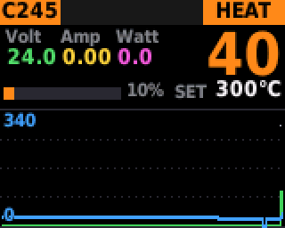 | 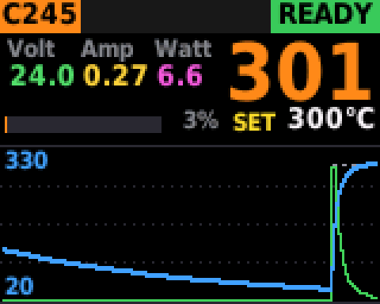 |

Khi nhiệt thay đổi nhanh (làm nóng, nguội), số trên màn hình cập nhật khoảng 4 lần mỗi giây và trượt nhanh hơn, để mỗi giá trị đứng yên đủ lâu cho mắt đọc. Khi đang giữ nhiệt, dao động ±1 °C ngắn hơn 0,4 giây không được hiển thị.

## Khởi động

| Bật nguồn, đã cắm mũi | Bật nguồn, chưa cắm mũi |
| --- | --- |
|  |  |

Hiện 3,5 giây (bấm để bỏ qua), sau đó vào màn hình chính.

## Màn hình chính

| Đang tắt (OFF) | Đang nóng lên (HEAT) |
| --- | --- |
| 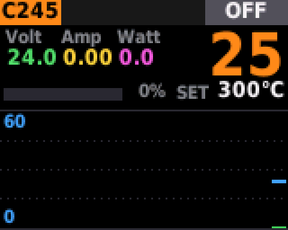 | 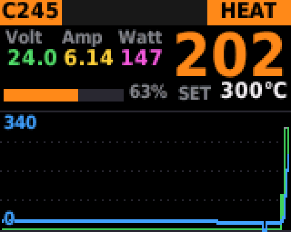 |
| **Đã đạt nhiệt (READY)** | **Xoay núm: SET vàng = chưa lưu, bấm 1 lần để lưu** |
| 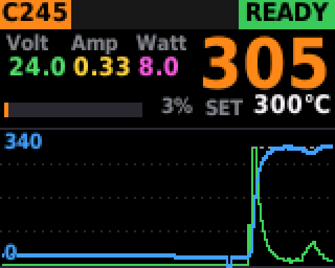 | 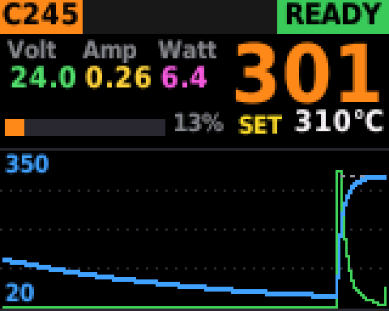 |

## Boost

| Đang nóng lên tới nhiệt Boost | Đã đạt, đếm ngược ở ô bên phải |
| --- | --- |
| 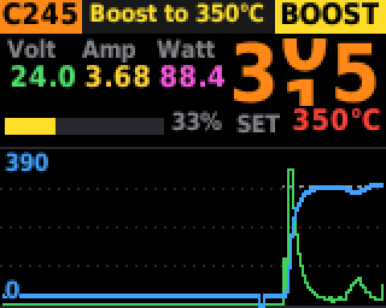 | 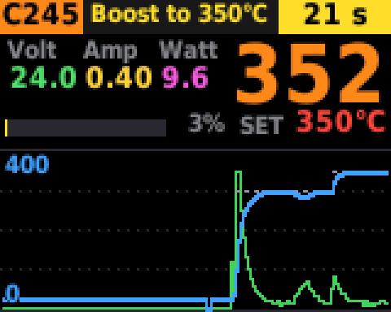 |

## Sleep

| Vừa gác lên giá: đếm ngược tới lúc ngủ | Đang ngủ: giữ nhiệt thấp, đếm ngược tới lúc tắt nung |
| --- | --- |
| 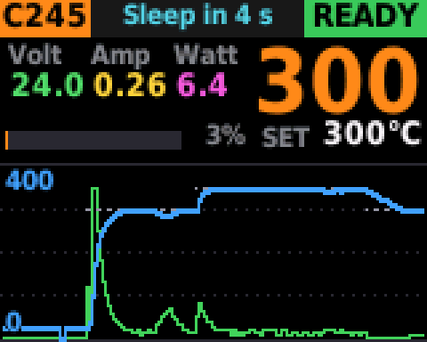 | 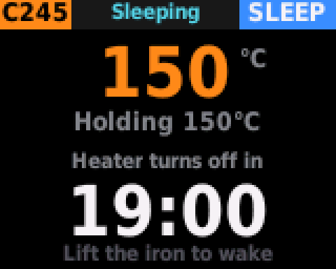 |

## Khi tắt nung

| Mũi còn nóng | Mũi đã nguội | Hết giờ Sleep (đèn nền dịu) |
| --- | --- | --- |
|  |  |  |

## Cài đặt

| Trang 1 | Trang 2 |
| --- | --- |
| 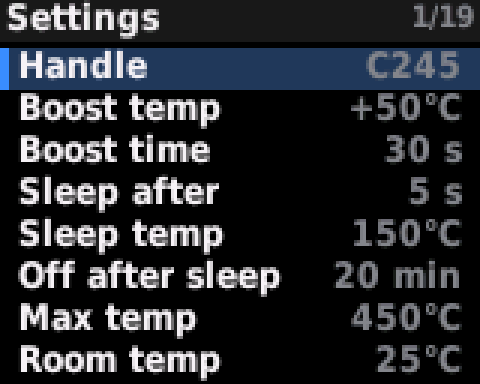 | 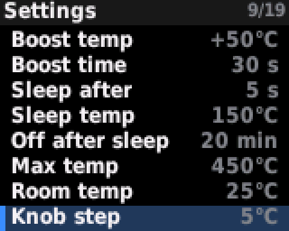 |
| **Trang 3** | **Đang sửa một mục (viền cam)** |
| 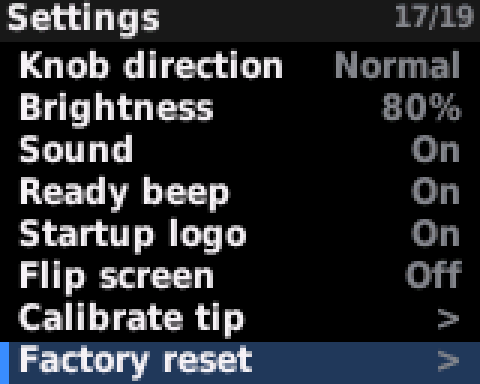 | 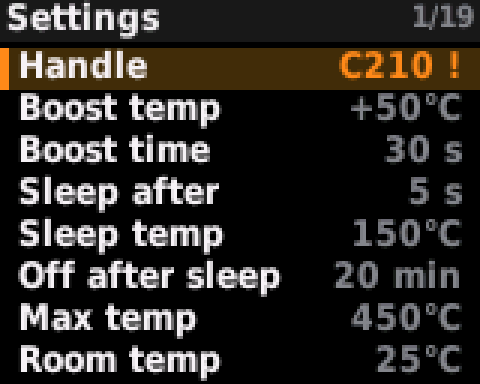 |

Giữ núm 0,8 giây để vào hoặc thoát. Xoay để chọn, bấm để sửa, xoay để đổi giá trị, bấm để xong.

## Hiệu chuẩn tay hàn

| Hướng dẫn | Đang hiệu chuẩn (bước 1/6) |
| --- | --- |
| 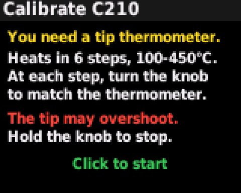 | 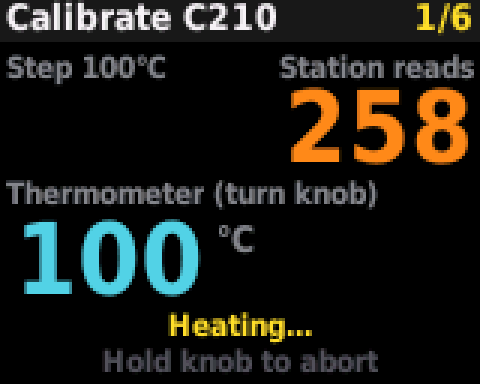 |

## Khác

| Thông tin (About) | Báo lỗi |
| --- | --- |
| 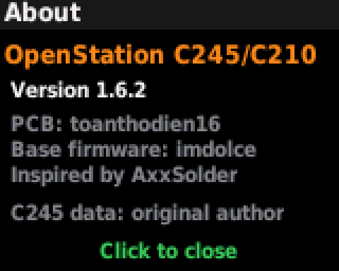 | 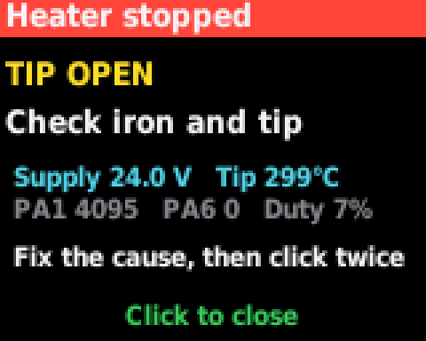 |

## Bộ điều khiển nhiệt (mô phỏng)

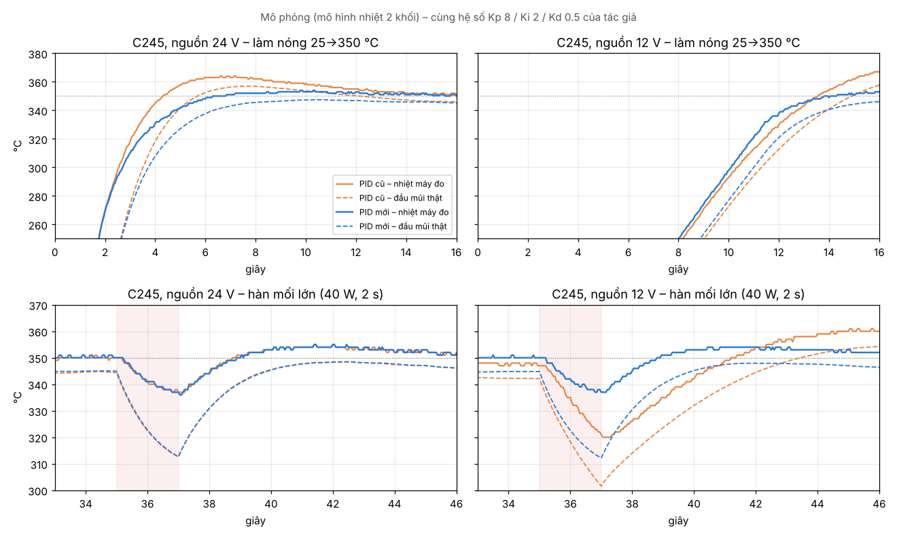

So sánh PID cũ và mới khi làm nóng và khi hàn mối lớn, ở nguồn 24 V và 12 V. Chi tiết trong [README](../README.md#bộ-điều-khiển-nhiệt).
